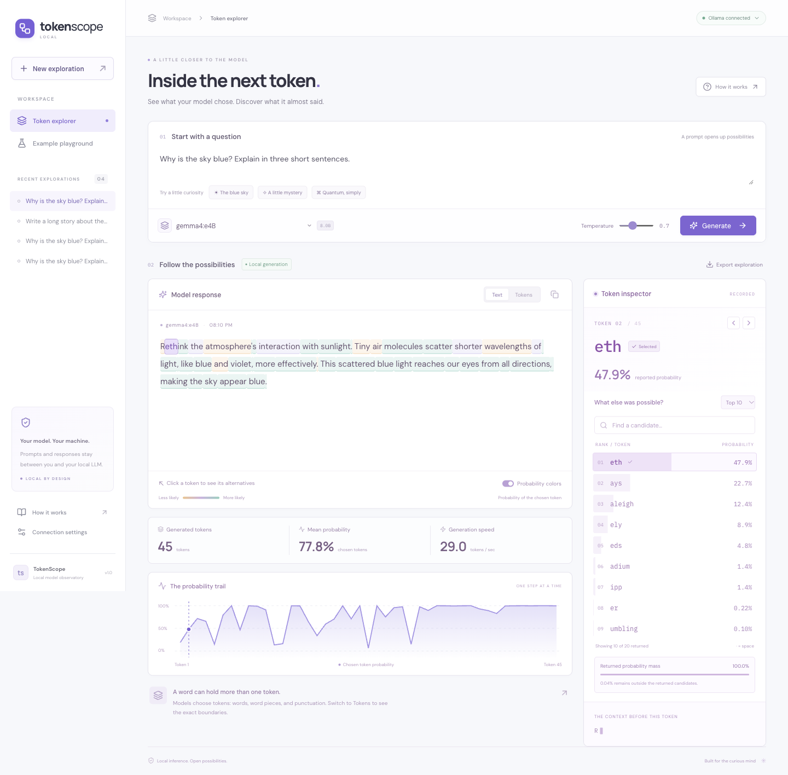
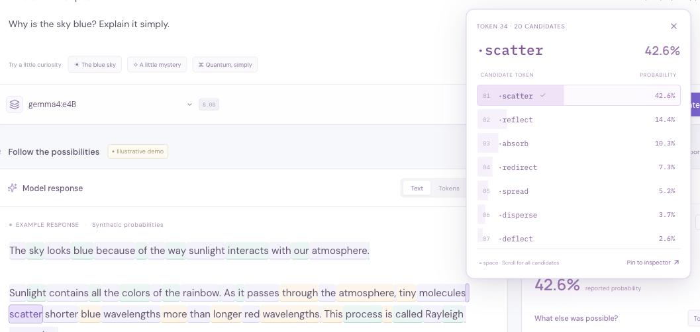
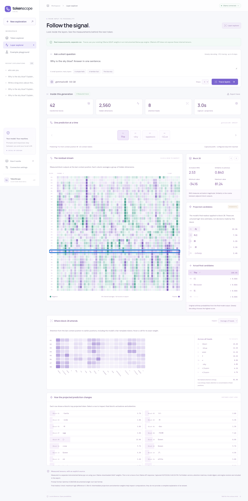

# TokenScope

**See what your local language model chose—and what it almost said.**

TokenScope is a local web app for exploring candidate tokens, probabilities, and transformer layers. Connect Ollama or llama.cpp, ask a question, then hover over or click any token to inspect its alternatives. Use **Layer explorer** to capture real internal measurements in a separate instrumented run using compatible weights already downloaded by Ollama.



## Features

- **Hover previews:** see candidate words and their probabilities beside each token, scroll the full returned list, or pin it to the inspector.
- **Token inspector:** ranked alternatives, candidate search, previous/next navigation, and probability mass outside the returned candidates.
- **Text and token views:** read the original response or inspect exact token boundaries, including spaces, punctuation, and word fragments.
- **Probability visualization:** optional token colors and an interactive chart of the chosen token's probability across the response.
- **Layer explorer:** measured activation heatmaps, attention by head and context position, intermediate token projections, and generation-step navigation.
- **Local model discovery:** choose an installed model and configure temperature, output length, candidate count, and random seed.
- **Exploration history and export:** revisit recent runs in the same browser and download the complete record as JSON.
- **Responsive interface:** desktop and mobile layouts, keyboard focus previews, and Escape to dismiss previews.
- **Local operation:** inference goes through a local server, and fonts are bundled with the app.



## Quick start

### Requirements

- Node.js **20.19+** or **22.12+**, including newer supported releases, and npm.
- [Ollama](https://ollama.com/) with a downloaded text-generation model, or a recent [llama.cpp server](https://github.com/ggml-org/llama.cpp/tree/master/tools/server).
- A model and runner that return token probability metadata.

### Install and run

```sh
git clone https://github.com/Amir-Parsian/llmMonitor.git
cd llmMonitor
npm ci
npm run dev
```

Open **[http://127.0.0.1:5173](http://127.0.0.1:5173)**.

The app discovers Ollama models at `http://127.0.0.1:11434`. If Ollama is not running, open the Ollama app or run this in another terminal:

```sh
ollama serve
```

If you need a model, download one, for example:

```sh
ollama pull gemma4:e4B
```

The built-in **Illustrative demo** works before a model is connected. Its probabilities and tokenization are synthetic and labeled accordingly.

### Production build

```sh
npm run build
npm start
```

The production app also runs at `http://127.0.0.1:5173`. To choose another port:

```sh
PORT=5174 npm start
```

The app binds to `127.0.0.1`. The UI and backend share an origin, so no Ollama CORS changes are needed.

## How to explore

1. Write a prompt and choose a local model.
2. Adjust temperature if desired, then select **Generate**. **Cmd/Ctrl + Enter** also generates.
3. Hover over a token for a scrollable candidate preview. Click it, or select **Pin to inspector**, to inspect it in the side panel.
4. Switch between **Text** and **Tokens**, toggle probability colors, or select a position in the probability chart.
5. Search candidates or move between tokens with the inspector arrows.
6. Select **Export exploration** to download the prompt, response, generation settings, and recorded probabilities as JSON.

Open **Connection settings** to change the server, requested candidate count, maximum output length, or seed. A fixed seed can help compare runs; exact repeatability depends on the model server.

Each generation is independent. Previous explorations are not sent as chat history. Recent explorations and settings are stored in this browser's local storage, up to 12 runs within the browser's storage capacity. Use Export to keep larger or important records.

## Model servers and candidate limits

| Provider  | Default address          | Candidates per token  | Integration                                               |
| --------- | ------------------------ | --------------------- | --------------------------------------------------------- |
| Ollama    | `http://127.0.0.1:11434` | Request up to **20**  | Native `/api/chat` with `logprobs` and `top_logprobs`     |
| llama.cpp | `http://127.0.0.1:8080`  | Request up to **100** | Native `/apply-template` and `/completion` with `n_probs` |

### Ollama

TokenScope requests `logprobs: true`, `stream: false`, `think: false`, and the selected `top_logprobs` count. Ollama currently limits `top_logprobs` to 20. Support depends on the installed version and model runner.

If the server does not return probabilities or alternatives, the app explains what is missing and preserves the response. It does not invent probabilities.

Real generation has been verified with **Ollama 0.40.1 and `gemma4:e4B`**.

### llama.cpp

Run a recent llama.cpp server with a compatible GGUF model:

```sh
llama-server -m /absolute/path/to/model.gguf --port 8080
```

Choose **llama.cpp** in Connection settings. TokenScope discovers models through `/v1/models`, applies the model's chat template through `/apply-template`, and requests probabilities through native `/completion` with `n_probs` and `post_sampling_probs: false`.

The adapter accepts both `probs` and `completion_probabilities` response fields. Servers may return fewer candidates than requested. A chosen token outside the shortlist is retained, so the displayed list may contain one additional selected token.

The llama.cpp integration is covered by contract tests against a simulated server. A live llama-server model run has not been verified in this project.

You may be able to use a compatible GGUF blob already downloaded by Ollama. Compatibility depends on your llama.cpp build. The token explorer connects to your existing model server; the optional layer tracer loads existing compatible weights itself, as described below.

## Layer explorer

Most current autoregressive chat LLMs have a stack of transformer blocks. TokenScope can measure how the residual state and attention change across those blocks while the model predicts the next token.

**Ollama's normal API does not expose these internal tensors.** Layer explorer runs a separate, instrumented llama.cpp process against your existing local GGUF weights. It does not inspect an Ollama API response, reconstruct an earlier run, or promise identical output to Ollama. No layer measurements are simulated.



### Build the tracing engine once

In addition to the normal app requirements, use macOS or Linux with a C++17 compiler, a native build tool such as Make, and `tar`. On macOS, Apple's Command Line Tools provide these. CMake 3.20+ is required; if CMake is missing, the setup script uses Python 3 and pip to install it into the project's `.runtime` folder.

```sh
npm run setup:tracer
npm run dev
```

Setup downloads official llama.cpp source pinned to [`9d1878a4354e743529fbe09e7350a957f5e39e9a`](https://github.com/ggml-org/llama.cpp/tree/9d1878a4354e743529fbe09e7350a957f5e39e9a) and compiles the adapter in `native/`. It downloads no model weights. The engine, source, and build files stay in the ignored `.runtime/` directory. The current build uses the CPU with flash attention disabled so individual attention weights are available.

The tracer discovers GGUF files through installed manifests in `~/.ollama/models`, or `OLLAMA_MODELS` if set. Recent Ollama downloads can contain an Ollama-specific format and a separate llama.cpp variant; TokenScope prefers an already-installed llama.cpp variant. It reads weights in place without converting or duplicating them. If only an incompatible layout is installed, the run reports the loading error.

### Inspect a real generation

1. Select **Layer explorer** in the sidebar.
2. Choose a downloaded model, enter a short question, and select 1, 2, 4, or 8 generation steps.
3. Select **Trace layers**. Progress reports loading, tensor capture, and intermediate projections. **Stop** terminates the tracing process.
4. Choose a generated token to inspect the computation that predicted it. For the first token, the measured query is the last prompt position; subsequent steps use the preceding generated token.
5. Select a block in the activation map or prediction trail. Hover over activation or attention cells for exact values, and choose a head to inspect its strongest attention weights.
6. Select **Export trace** to save the measurements, prompt tokens, model digest, prompt-format source, and engine revision as JSON. Switching between the two explorers preserves the current trace; reloading the page clears it.

### What the measurements mean

| View                    | Recorded data                                                                                                                                                                           |
| ----------------------- | --------------------------------------------------------------------------------------------------------------------------------------------------------------------------------------- |
| Residual stream         | Each block's output vector at the last context position, displayed as 64 contiguous channel averages. Full vectors are exported.                                                        |
| Block inspector         | Activation RMS, minimum, maximum, and cosine similarity to the preceding block output.                                                                                                  |
| Attention               | Actual post-softmax attention weights from the last query position to context positions, for every captured head in the selected block. Chat-template tokens are included.              |
| Projected candidates    | An **untuned logit lens**: the model's final normalization and output head applied to an intermediate residual state. These are diagnostic estimates, not decisions made by that block. |
| Actual final candidates | Full-vocabulary softmax probabilities from the model's real final logits. Greedy decoding selects the highest score.                                                                    |
| Prediction trail        | Each block's top projected next token, with the original probability rather than a renormalized shortlist.                                                                              |

Attention weights describe one part of the computation; they are not a complete causal explanation of an answer. Intermediate projections may look nonsensical in early blocks. The tracer compares the last projected logits with the actual final logits and includes the maximum difference in the interface and export.

### Compatibility and limits

Real end-to-end tracing has been verified on **macOS arm64 with `gemma4:e4B`**: 42 blocks, 2,560 hidden dimensions, and 8 attention heads. The final projected logits matched the actual output logits in the verification run. The Gemma E2B/E4B fallback uses Google's documented non-thinking text format; larger Gemma 4 variants use the canonical template from the pinned llama.cpp source when no template is embedded in the GGUF.

Other models are discovered by their GGUF headers, but architecture and template compatibility vary. Missing block outputs cause a clear error. Missing attention or an unsupported logit-lens readout is identified in the interface. The initial logit-lens adapter supports standard RMS-normalized Llama, Gemma, Qwen2, and Qwen3 readouts; it does not claim universal model support.

Tracing is intentionally bounded: one job at a time, at most 1,200 question characters, 256 formatted prompt tokens, 8 generated tokens, five minutes, and 64 MB of trace output. Models whose weight files exceed 70% of physical memory are disabled; models below that threshold still need memory for inference. A trace is a captured response prefix, so a short run can end mid-sentence. CPU tracing and full-vocabulary projections are slower than normal generation.

Verify a real installed model with:

```sh
npm run test:trace
# Or choose another compatible downloaded model:
npm run test:trace -- gemma4:e4B
```

This integration check runs actual inference, validates full hidden vectors and attention normalization, checks the final logit-lens readout when available, and saves `.runtime/verified-trace.json`. It is separate from the fast backend tests and requires the built tracer plus a compatible model.

## Understanding the probabilities

Language models generate **tokens**, which may be whole words, word fragments, spaces, punctuation, or byte fragments. At each position, the model scores possible next tokens based on the prompt and previously generated tokens. Sampling settings influence which token is chosen; the most likely candidate does not always win.

TokenScope displays `exp(logprob)` as reported by the provider. It preserves the original probabilities and does **not** rescale the visible shortlist to sum to 100%. The inspector shows probability mass outside the returned list.

Provider-reported probabilities can differ from the final sampling distribution, depending on the server and sampler chain. These numbers express token likelihood, **not factual accuracy or confidence that an answer is correct**. The mean and chart summarize the reported probabilities of the chosen tokens.

Probabilities must be recorded **during generation**. Copying a response from another chat cannot recover its original candidate distributions.

## Privacy and storage

- Prompts travel from the browser through the local Node server to the selected loopback model endpoint.
- The backend accepts only local model server URLs and rejects cross-origin API requests.
- The app requires no API key or hosted service. With a downloaded model and local inference server, it runs locally; the interface makes no external font requests.
- Settings and recent explorations remain in browser local storage until cleared. Exports are saved only when requested.
- Layer traces use the local filesystem and native engine, remain in page memory, and are saved only when exported or when explicitly running the integration verifier.
- Connecting to an Ollama endpoint does not by itself make a cloud-backed model local. Choose a downloaded model for local inference.

## Development

Built with React, TypeScript, Vite, Lucide icons, and Node's native HTTP server.

| Command                | Purpose                                       |
| ---------------------- | --------------------------------------------- |
| `npm ci`               | Install the locked dependency versions        |
| `npm run dev`          | Run the local API and Vite interface          |
| `npm run build`        | Type-check and build the production interface |
| `npm start`            | Serve the production build and local API      |
| `npm test`             | Run the backend tests                         |
| `npm run setup:tracer` | Build the optional native layer tracer        |
| `npm run test:trace`   | Verify actual tracing with an installed model |

```text
src/
  App.tsx                 Main interface and exploration state
  TokenHoverPreview.tsx   Hover and keyboard candidate previews
  LayerExplorer.tsx       Measured activation, attention, and logit-lens views
  layerTypes.ts           Layer trace protocol types
  layers.css              Layer explorer styles
  demo.ts                 Labeled illustrative example
  format.ts               Shared probability and token formatting
  styles.css              Responsive interface styles
  types.ts                Shared frontend data types
server/
  index.mjs               Local HTTP API and frontend server
  providers.mjs           Ollama and llama.cpp integrations
  providers.test.mjs      Provider, probability, and API tests
  tracing.mjs             Native process control and installed GGUF discovery
  tracing.test.mjs        Trace validation and model discovery tests
native/
  tracer.cpp              Instrumented llama.cpp evaluation and readout
  CMakeLists.txt          CPU tracing engine build
scripts/
  setup-tracer.mjs        Pinned runtime download and native build
  verify-tracer.mjs       Real-model integration verification
public/
  fonts/                  Bundled fonts and their licenses
docs/screenshots/         Interface screenshots
```

The backend validates generation controls, normalizes provider responses, preserves UTF-8 byte offsets, and aborts inference requests when the client disconnects. The response is delivered after generation completes, together with the recorded token metadata. **Stop** cancels the current run and discards late results.

The backend tests cover probability conversion, shortlist mass, selected tokens outside the shortlist, UTF-8 fragments, reasoning-token alignment, provider requests, 100-candidate llama.cpp responses, model discovery, missing metadata, and API validation, plus bounded trace requests and reuse of installed GGUF variants. Browser verification covers hovering, scrolling candidates, pinning, search, display modes, keyboard dismissal, cancellation, export, and responsive layout.

## Troubleshooting

| Issue                             | What to check                                                                                                                  |
| --------------------------------- | ------------------------------------------------------------------------------------------------------------------------------ |
| Cannot connect to Ollama          | Open Ollama or run `ollama serve`, check the URL in settings, then reconnect.                                                  |
| No text models are listed         | Download a text-generation model and reconnect. Image-only models are excluded where capabilities are reported.                |
| Response has no probability data  | Try a newer model server or another model/runner. Text alone cannot supply the missing data.                                   |
| Only 20 candidates are available  | This is Ollama's current API limit. Connect llama.cpp to request up to 100.                                                    |
| Response ends mid-sentence        | Increase **Maximum output tokens**. The app reports when the output limit is reached.                                          |
| Port 5173 is already in use       | Stop the other instance or set `PORT`, for example `PORT=5174 npm run dev`.                                                    |
| Interface changes are not visible | Rebuild the production app and refresh the browser. Vite updates interface files automatically in development.                 |
| Layer engine is not ready         | Run `npm run setup:tracer`, then select **Check again** in Layer explorer.                                                     |
| GGUF cannot be loaded             | The installed weight layout or architecture may be incompatible with the pinned llama.cpp engine. Try another installed model. |
| No chat template is available     | Use a GGUF with an embedded template or one of the supported Gemma 4 fallbacks.                                                |
| Layer trace is slow               | Choose fewer steps, a shorter question, or a smaller model. The current tracer uses the CPU.                                   |

## License

TokenScope's original source code is available under the [MIT License](LICENSE), copyright © 2026 Amir Parsian. Bundled fonts retain their [SIL Open Font License notices](public/fonts/); dependencies and model weights remain subject to their respective licenses.

## References

- [Ollama chat API](https://docs.ollama.com/api/chat)
- [Ollama request types and candidate limits](https://github.com/ollama/ollama/blob/main/api/types.go)
- [llama.cpp server documentation](https://github.com/ggml-org/llama.cpp/tree/master/tools/server)
- [Hugging Face text generation guide](https://huggingface.co/docs/transformers/main/en/llm_tutorial)
- [Google's Gemma thinking modes and prompt formats](https://ai.google.dev/gemma/docs/capabilities/thinking)
- [Pinned llama.cpp evaluation callback API](https://github.com/ggml-org/llama.cpp/blob/9d1878a4354e743529fbe09e7350a957f5e39e9a/include/llama.h)
